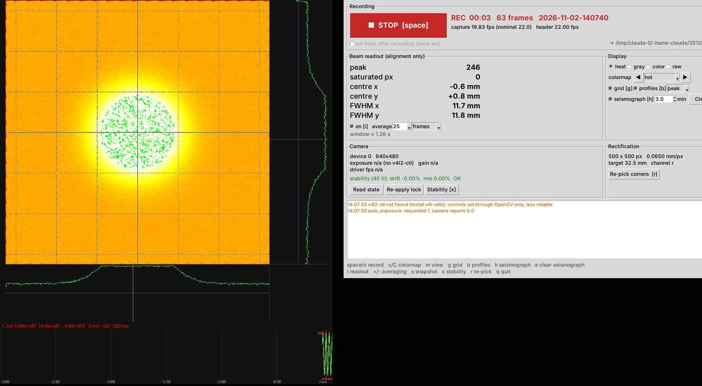
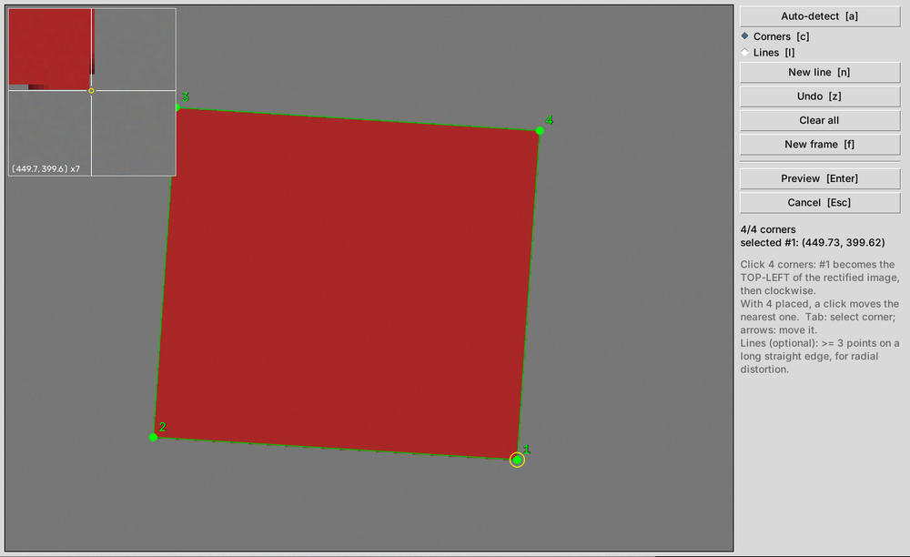

# scintcam

Live, rectified view and lossless recording of a scintillator screen (or any flat square target) seen obliquely by a
webcam, built for beam-profile monitoring at small accelerators.

You pick (or auto-detect) the four corners of the target once; every frame is then mapped to target coordinates in mm
and shown with the beam profiles, a quick centre/FWHM readout and a rolling trace of the total light. Recording writes
the raw and rectified video losslessly, the capture time of every frame, the camera state actually in use and the
geometry, so the clips can be analysed quantitatively later.


*Simulated camera. Left: view window (rectified image, x/y profiles, total-light trace). Right: controls window.*

## Why

- **The camera is a measuring device here.** Webcam firmware adjusts exposure, gain, white balance and focus on its
  own, and the beam turning on is exactly what triggers it, so the recorded intensity would follow the control loop
  rather than the screen. scintcam pins those controls, reads back the state the driver is really in, logs it with
  every clip, and warns if it changes during a recording.
- **Capture is never slowed by the display.** Reading, rectifying and recording run in their own threads; the windows
  show the newest frame at their own pace. With a 22 or 30 fps camera the recorded rate equals the camera rate with
  the GUI running (frame-interval jitter below 2 ms on a 2-core machine).
- **Timing does not rely on the file header.** Each clip comes with the capture time of every frame.

## Install

Python 3.8 or newer, with OpenCV, numpy, Pillow and Tk (`tkinter`).

```bash
conda create -n scintcam python=3.10 && conda activate scintcam
git clone https://github.com/dasyamfigari/scintcam && cd scintcam
pip install -e ".[opencv,radial]"     # drop "opencv" if your environment already has cv2
```

Linux: install `v4l-utils` (`sudo apt install v4l-utils`). Camera controls are then set and read with `v4l2-ctl`,
which is far more reliable than OpenCV for UVC webcams. If `tkinter` is missing: `sudo apt install python3-tk`
(system Python) or `conda install tk`.

## Quick start

```bash
scintcam --print-config > my_setup.toml     # full list of settings, all commented
# keep only what you change; at least the target size:
#   [rectify]
#   target_mm = 32.5
scintcam probe -c my_setup.toml             # which camera modes really stream
scintcam -c my_setup.toml
```

1. The camera opens, its automatic controls are pinned, and a stability check measures the level drift on the static
   scene (it should say OK; the beam must be off).
2. The **picker** opens on a frozen frame. Press **Auto-detect** (room lights on, beam off) or click the four corners.
   Corner 1 becomes the top-left of the rectified image, then clockwise. Check the corners in the loupe, move the
   selected one with the arrow keys (Tab selects), then **Preview** and **Use this geometry**. The geometry is saved
   and offered again next time.
3. Live view: **space** starts and stops a recording.
4. Camera settings: the **Camera** panel shows exposure (ms), gain, gamma, brightness, contrast and saturation as
   read back from the driver. Type new values and press **Apply** (or Enter): the auto → manual exposure switch is
   made for you and the fields then show what the camera accepted. **Save to config** writes the typed values into
   `[camera.controls]` of the config file (other lines and comments are kept). Apply is disabled while recording.
   The **auto exposure** box switches the camera's automatic exposure on (field disabled, orange warning: intensities
   are not comparable between frames or clips) or off (the camera keeps the last exposure it chose, the usual
   "lights on, auto, then manual" procedure). Starting a recording with it on logs a warning.



## Two windows, two monitors, remote sessions

The view and the controls are separate top-level windows, so each can sit on its own monitor. Their positions are
remembered between runs (`gui.state_file`), or can be fixed in the config:

```toml
[gui]
view_geometry = "1000x1050+0+0"     # left monitor
controls_geometry = "+1930+0"       # right monitor
```

Over **X2Go**, run it as a *single application* session (like a "Compass only" session): command
`sh -c "cd /path/to/setup && /path/to/env/bin/scintcam -c my_setup.toml"`. Both windows appear on the client
desktop and can be dragged to either screen. Capture and recording stay on the acquisition PC; only the display
travels, and a slow link cannot slow the recording down. Leave the session with *Suspend*.

## What a recording writes

In `recording.dir`, with `stem` = start time `YYYY-MM-DD-HHMMSS`:

| File | Content |
|---|---|
| `<stem>.mkv`, `<stem>_rect.mkv` | raw and rectified video (`recording.source`), FFV1 lossless |
| `<stem>_frames.csv` | `frame, t_s, t_driver_ms`: host time of every frame and the driver timestamp |
| `<stem>_settings.json` | written at start, completed at stop: camera controls read back from the driver at start and stop (exposure in ms, gain, every control, changes during the clip), last stability check, the full rectification (corners, homography, distortion, mm/px, channel) |
| `<stem>.done` | written **last**, after every other file is closed: the clip is complete. Watchers on other machines can wait for it. `"files"` lists the videos only. It also carries the camera state at the start in flat keys: every V4L2 control by its driver name, `exposure` (100 µs units, manual mode only), `format`, `camera_locked`, `stab_drift_pct`, `stab_rms_pct` |
| `rectify_points.json` | geometry of each raw clip under its file name, schema of `beamview.write_rectification` (offline tools need no re-picking) |

A crash writes no `.done`, so an incomplete clip is never picked up automatically.

**Hook.** A command can run after each recording, in the background:

```toml
[hooks]
on_recording_done = ["python3", "/path/analyse.py", "{rect}", "--settings", "{settings}"]
```

Placeholders: `{raw} {rect} {settings} {timestamps} {stem} {dir}`. Output goes to `<stem>_hook.log`.

## Keys

| Key | | Key | |
|---|---|---|---|
| space / v | record / stop | m | view: heat, gray, colour, raw |
| c / C | next / previous colormap | g | grid and crosshair |
| b | profile strips | h | total-light trace |
| e | clear the trace | i | readout on/off |
| + / - | averaging window | s | PNG snapshot |
| x | stability check | r | re-pick corners |
| q | quit | | |

Picker: `a` auto-detect, `c`/`l` corners/lines, `n` new line, `z` undo, `f` new frame, Tab select corner, arrows
move it, Enter preview/accept, Esc back/cancel.

## Measurement notes

- **Readout is for alignment.** Centre and FWHM come from the row and column through the peak after a percentile
  background; they are not fitted sizes. With saturated pixels the FWHM is over-estimated (the half level is taken
  from the clip level): keep *saturated px* at 0. Averaging N **frames** reduces the noise bias of the width;
  averaging N **values** only shows the scatter of independent estimates. Both average over N/fps seconds, so they
  smear the turn-on and the afterglow.
- **Total-light trace** = sum of the analysis channel over the rectified frame, sampled at every captured frame.
  Each pixel column shows the min and max of its samples, so short beam trips stay visible; red marks under the trace
  are stretches with saturated pixels, where the sum is under-estimated.
- **Rectification** composes the radial correction and the homography into one lookup map, so each frame is
  interpolated once. Radial distortion is fitted from lines picked on straight edges; short edges near the image
  centre cannot constrain it, use long edges far from the centre.
- **Exposure.** UVC exposure is in units of 100 µs (400 = 40 ms) and must fit in one frame period (1/fps). Many UVC
  cameras only apply a manual exposure on the auto → manual transition; with `camera.exposure_cycle` the switch is
  made for you, and the driver frame rate is checked to confirm the value was applied. If you set exposure by another
  procedure, leave `exposure` out of `[camera.controls]`: it is then not touched, and the value in use is logged.
  Values out of the driver's range are refused in the Camera panel, with the range in the log.

## Troubleshooting

- **`select() timeout` every 10 s:** the camera opened but cannot stream the requested mode (non-standard sizes such
  as 480x480 are the usual cause). `scintcam probe` lists the modes that really deliver frames; `camera.fallback`
  switches to one automatically. If it persists, the USB link or the camera is the problem (try another port; on
  Linux USB autosuspend is a common cause).
- **Exposure reads back correctly but nothing changes:** in auto mode `v4l2-ctl -l` shows `flags=inactive` on
  `exposure_absolute`; the value is stored but unused. See *Exposure* above.
- **"camera controls changed during the recording":** something else (another program, a camera app) touched the
  camera; the clip's intensities are not comparable across that change.
- **"the encoder fell behind":** the disk or CPU could not keep up; frames may have been dropped by the driver. Use
  `<stem>_frames.csv` for timing, record only the rectified stream, or lower the resolution.
- **Unknown setting error:** a misspelled key in your config. `scintcam --print-config` lists them all.

## Development

```bash
pip install -e ".[opencv,radial,test]"
pytest
```

The core (`camera`, `geometry`, `detect`, `engine`, `recorder`, `analysis`, `render`) has no GUI dependency; the Tk
GUI lives in `scintcam.gui`.

## License

MIT
